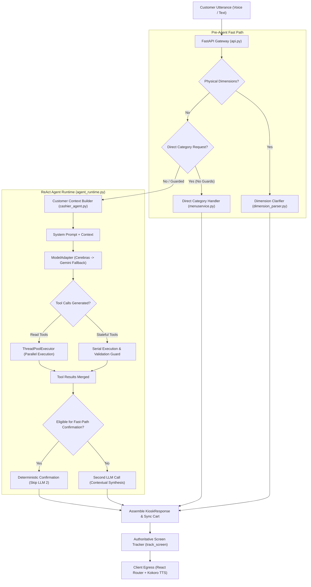
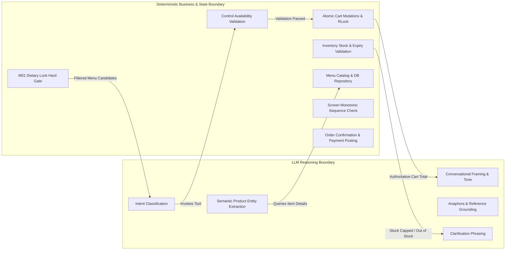
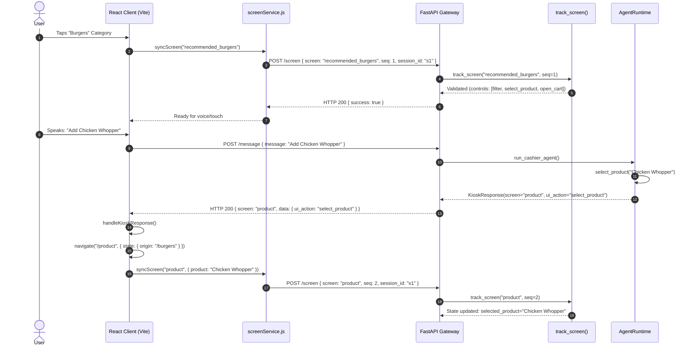
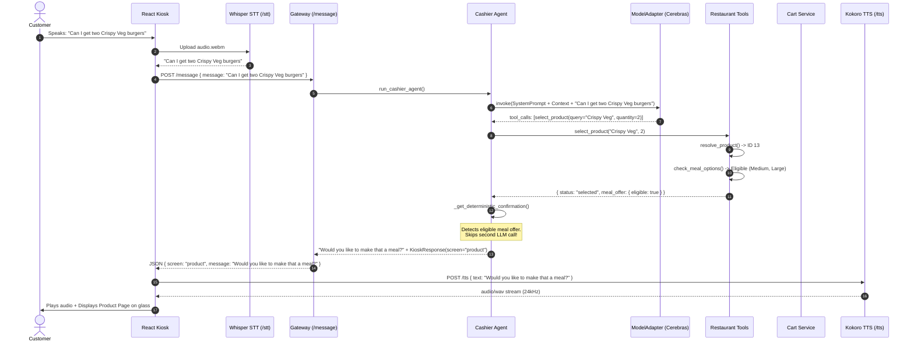

# Intelligent Agent Architecture & Replication Blueprint
**Reverse Engineering and Architectural Specification of TheAtom Conversational AI Cashier**

---

## 1. Executive Summary

This document presents an exhaustive architectural reverse-engineering of the conversational intelligence engine within the `Intelligent-agent` codebase of TheAtom. The goal of this technical investigation is to extract, document, and formalize the foundational patterns, data pipelines, state machines, and decision boundaries that power TheAtom's conversational cashier. This document serves as a complete implementation blueprint, enabling any software engineering team or AI coding agent to replicate the identical conversational intelligence in an entirely new domain (e.g., hospitality, retail, ticketing, automotive, or customer service) without any dependency on Burger King menu items, PostgreSQL schemas, or legacy code.

### 1.1 The Core Problem Solved by TheAtom
Traditional conversational agents typically fall into one of two failure modes:
1. **Scripted Decision Trees**: Fragile, robotic, unable to handle interruptions, anaphora ("add that one"), contextual changes of mind, or natural digressions.
2. **Unconstrained LLM Chatbots**: Hallucination-prone, computationally slow, unable to respect strict business rules (stock limits, dietary restrictions, atomic multi-item cart mutations), and disconnected from real UI state.

TheAtom resolves this duality by establishing a **hybrid multi-stage conversational architecture**. It couples non-deterministic LLM natural language understanding with deterministic state verification, authoritative UI synchronization, and transactional business gating. The LLM is never permitted to make standalone business decisions (such as setting prices, mutating cart balances, bypassing inventory limits, or declaring orders placed). Instead, the LLM functions strictly as an intent parser, contextual tool coordinator, and natural language response synthesizer. All state mutations, catalog lookups, and visual screen transitions are governed by deterministic backend controllers.

### 1.2 Key Architectural Highlights
- **Dual-Tier Conversation Routing**: An optimized hybrid pipeline featuring a high-performance **Fast-Path Pattern & Dimension Guard** (sub-2ms), a **React-Style Tool-Calling Agent** (`AgentRuntime`) as the primary brain, and a **Screen-Aware Intent Pipeline** (`process_message`) as a resilient fallback.
- **Strict Decoupling of Three State Domains**: Clear architectural boundaries separating **Authoritative UI State** (active screen and controls), **Transactional Cart State** (thread-safe, idempotent operations), and **Conversational Memory** (chat history and historical item references).
- **Multi-Provider LLM Resilience**: A high-speed primary LLM provider (Cerebras `qwen-3.8-27b`, ~300ms latency) backed by bounded timeouts (3.5s) and automatic failover to Google Gemini (`gemini-3.1-flash-lite`, 4.0s timeout), with automatic sanitization of cryptographic tool signatures.
- **Deterministic Fast-Path Confirmation**: Eliminates unnecessary second LLM roundtrips after stateful actions (e.g., `add_to_cart`, `set_quantity`, `decline_meal`), cutting total response latency by 40–60% while eliminating assistant hallucinations.
- **Monotonic Screen Synchronization**: Full-duplex client-backend synchronization utilizing monotonic sequence counters (`seq`) and session validation to guarantee that touch and voice interactions never experience stale screen race conditions.
- **Barging-In Voice Loop**: Full duplex voice interaction combining client-side Web Audio capture, server-side Whisper speech-to-text (`small.en`), server-side Kokoro neural text-to-speech (`af_heart`), and instant interruption handling.

---

## 2. System Architecture Overview

TheAtom's intelligence layer operates as a stateful conversational coordinator positioned between the multimodal user interface (React touch kiosk and microphone) and the backend enterprise services (Menu Service, Inventory, Cart, and Order Management).

```
                      +-------------------------------------------------------------+
                      |                      CLIENT INTERFACE                       |
                      |  - React Kiosk (Touch UI & Router)                          |
                      |  - VoiceConversationProvider (MediaRecorder & Web Audio)    |
                      +------------------------------+------------------------------+
                                                     |
                                   HTTP / REST (JSON + WebM Audio)
                                   Header: X-Interaction-ID
                                                     |
                                                     v
+---------------------------------------------------------------------------------------------------+
|                                      FASTAPI GATEWAY (api.py)                                     |
|  - Request Tracing & Monotonic Sequence Validation (perf.py)                                      |
|  - Local Speech-to-Text Pipeline (Whisper via ffmpeg)                                             |
|  - Local Text-to-Speech Pipeline (Kokoro TTS 24kHz)                                               |
+--------------------------------------------+------------------------------------------------------+
                                             |
                                             v
+---------------------------------------------------------------------------------------------------+
|                                CONVERSATION COORDINATION LAYER                                    |
|                                                                                                   |
|  +---------------------------------------------------------------------------------------------+  |
|  | Fast-Path Direct Category Guard (resolve_category_request)                                  |  |
|  | Physical Dimensions Parser & Clarifier (parse_spoken_dimensions)                            |  |
|  +---------------------------------------------+-----------------------------------------------+  |
|                                                |                                                  |
|                                                v                                                  |
|  +---------------------------------------------------------------------------------------------+  |
|  | PRIMARY INTELLIGENCE: ReAct Cashier Agent (cashier_agent.py & agent_runtime.py)             |  |
|  |   - Model Adapter: Cerebras (qwen-3.8-27b) -> Fallback: Gemini (gemini-3.1-flash-lite)     |  |
|  |   - Dynamic System Prompt + Authoritative Customer Context Injection                        |  |
|  |   - Stage 1: Read-Only Tools (Parallelized via ThreadPool) + Product Resolution             |  |
|  |   - Stage 2: Screen Action & UI Control Execution (Serial & Guarded)                        |  |
|  |   - Fast-Path Deterministic Confirmation (Skips redundant 2nd LLM call)                    |  |
|  +---------------------------------------------+-----------------------------------------------+  |
|                                                | (If Agent produces empty/unhandled response)     |
|                                                v                                                  |
|  +---------------------------------------------------------------------------------------------+  |
|  | LEGACY FALLBACK: Two-Tier Intent Recognizer (kiosk_service.py)                              |  |
|  |   - Screen Intent Extractor (extract_screen_intent) -> create_ui_action                     |  |
|  |   - Global Intent Extractor (extract_intent) -> Domain Service Dispatch                     |  |
|  +---------------------------------------------------------------------------------------------+  |
+--------------------------------------------+------------------------------------------------------+
                                             |
                                             v
+---------------------------------------------------------------------------------------------------+
|                                 DETERMINISTIC BUSINESS LOGIC & GUARDS                             |
|  - M01 Dietary Lock (Strict Veg / Non-Veg Filtering)                                              |
|  - M02/M03 Role-Aware Basket Completion & Sensory Affinity Matrix                                 |
|  - M05 Budget Ceiling (Cart Price Ratio Constraints)                                             |
|  - M06 Condiment Host Gating & Checkout Cross-Sell                                                |
|  - M07 Absolute Cart Exclusion (Prevents redundant recommendations)                               |
|  - In-Memory Product Resolution Index (_ProductIndex with O(1) Exact & Token Subsets)             |
|  - Thread-Safe Cart Manager with Multi-Operation Atomic Transactions & Idempotency                |
+--------------------------------------------+------------------------------------------------------+
                                             |
                                             v
+---------------------------------------------------------------------------------------------------+
|                                 DATA PERSISTENCE & CONTROL CENTRE                                 |
|  - Supabase / PostgreSQL (Menu, Inventory Stock, Expiry Tracking)                                 |
|  - TheAtom Control Centre API (Authenticated Order Ingestion, Checkout, Payments)                 |
+---------------------------------------------------------------------------------------------------+
```

### 2.1 The Reasoning Boundary
A core architectural principle of TheAtom is the strict **separation of reasoning from execution**:

| Responsibility | Handled By | Implementation Mechanism |
| :--- | :--- | :--- |
| Natural Language Understanding | Non-Deterministic LLM | Prompt instructions, tool calling schemas, semantic token extraction |
| Anaphora & Context Parsing | Non-Deterministic LLM + Helpers | Historical memory (`last_item`), ordinals parser, slot detection |
| Catalog Existence & Stock Checks | Deterministic Backend | `resolve_product`, `_is_stock_eligible`, `_is_expiry_eligible` |
| Dietary & Allergy Safety | Deterministic Backend | `apply_dietary_lock` (hard gate before scoring) |
| Price Calculations & Discounts | Deterministic Backend | Fixed backend constants (`MEAL_UPGRADE_PRICES`), DB lookups |
| Cart State Mutations | Deterministic Backend | `cart_lock` (RLock), atomic multi-op rollbacks, idempotency store |
| Screen Navigation Permissions | Deterministic Backend | `available_controls` list, screen sequence monotonic check |
| Spoken Response Framing | Non-Deterministic LLM | Contextual response generation with strict grounding constraints |

---

## 3. Complete Conversation Lifecycle

The conversation pipeline traces an incoming user utterance from raw transport through intent extraction, execution, and output rendering.

### 3.1 Step 1: Ingress via API Gateway
A customer message enters the backend through one of two FastAPI endpoints:
1. **Text Channel**: `POST /message` (`backend/api.py`, Line 379) receiving a JSON payload:
   ```json
   { "message": "Can I get a Chicken Makhani", "interaction_id": "perf_a1b2c3d4" }
   ```
2. **Voice Channel**: `POST /stt` (`backend/api.py`, Line 921) receiving a WebM/Opus audio multipart upload. The backend:
   - Spawns `ffmpeg` via `subprocess.run` to convert browser WebM audio to 16 kHz mono signed 16-bit PCM WAV (`backend/api.py`, Lines 980–997).
   - Passes the WAV file to local OpenAI Whisper (`small.en`, FP16=False) (`backend/api.py`, Lines 1025–1031).
   - Returns transcribed text to the client, which immediately invokes `POST /message`.

Both ingress methods initialize a performance correlation context via `extract_or_create_tracer()` (`backend/perf.py`, Line 91), binding a unique `interaction_id` to the current execution thread/coroutine using Python's `contextvars.ContextVar`.

### 3.2 Step 2: Context State Preparation
In `backend/api.py` (Lines 394–411), incoming request parameters are recorded into the global state dictionary `conversation_context`:
```python
conversation_context["current_user_message"] = request.message
conversation_context["current_interaction_id"] = tracer.interaction_id
conversation_context["current_idempotency_key"] = (
    request.interaction_id or raw_req.headers.get("X-Idempotency-Key") or tracer.interaction_id
)
conversation_context.pop("_last_kiosk_response", None)
conversation_context.pop("_last_action_rejected", None)
```

### 3.3 Step 3: Fast-Path Pre-Agent Screening
Before invoking any LLM, the system executes deterministic fast-path evaluation:
1. **Order Completion Terminal Check**: If `current_screen == ScreenTypes.ORDER_COMPLETE`, the system immediately returns a terminal message prompting the user to collect their receipt, preventing accidental order re-entry (`backend/api.py`, Lines 419–424).
2. **Physical Dimensions & Measurement Clarifier**: Spoken statements containing dimensional measurements (e.g., *"8 feet 8, 11 feet 8"*, *"12 inches"*) are parsed by `parse_spoken_dimensions()` in `backend/services/dimension_parser.py` (Lines 35–98). Because restaurant items are never sold by dimensional footage, the system halts LLM invocation and returns an instant clarification (`backend/api.py`, Lines 429–439).
3. **Direct Category Fast-Path Guard**: `resolve_category_request(message)` (`backend/api.py`, Lines 281–376) deterministically detects generic category navigation requests (e.g., *"I want a burger"*, *"Have in a burger"*, *"Show me drinks"*).
   - **Specific-Product Guard**: Over 100 guard tokens (modifiers like *"extra"*, *"without"*; ingredients like *"cheese"*, *"bacon"*; product names like *"crispy"*, *"whopper"*; and quantities like *"two"*, *"3"*) immediately invalidate the category fast-path (`backend/api.py`, Lines 295–324).
   - If valid and current screen is not `meal_conversion`, it calls `handle_category()` (`backend/services/menuservice.py`, Line 368), updates `track_screen()`, and returns in **under 2 milliseconds**, bypassing the LLM completely.

### 3.4 Step 4: Primary Agent Invocation (`run_cashier_agent`)
If pre-agent screening does not handle the request, control transfers to `run_cashier_agent()` (`backend/services/cashier_agent.py`, Line 714):
1. **Customer Context Construction**: `build_customer_context()` (`backend/services/cashier_agent.py`, Lines 367–608) compiles active state into an authoritative text block injected into the LLM system prompt.
2. **Tool Instantiation**: Dynamic factory `create_agent_tools()` (`backend/services/cashier_agent.py`, Lines 638–648) instantiates screen-bound tools (`open_category` and `screen_action`) closed over `conversation_context`, combining them with static tools (`get_menu_item_details`, `get_recommendations`, `select_product`).
3. **Runtime Execution**: Handed off to `AgentRuntime.run()` (`backend/services/agent_runtime.py`, Line 74).

### 3.5 Step 5: LLM Invocation & Tool Execution Lifecycle
In `AgentRuntime.run()`:
1. Messages are assembled: `[SystemMessage(SYSTEM_PROMPT + CURRENT CUSTOMER CONTEXT), *history, HumanMessage(user_input)]`.
2. Tools are bound to `ModelAdapter` (Cerebras primary, Gemini fallback).
3. First LLM invocation occurs (`llm_call_1`).
4. When `response.tool_calls` are present:
   - **Deduplication**: Tool calls with identical `(name, args)` within the turn are deduplicated (`backend/services/agent_runtime.py`, Lines 157–176).
   - **Two-Stage Dependency Ordering**:
     - *Stage 1*: Pure read-only lookups (`get_menu_item_details`, `get_recommendations`) and product resolution (`select_product`). If multiple read-only tools are called, they execute concurrently using Python's `concurrent.futures.ThreadPoolExecutor(max_workers=min(4, len(calls)))` (`backend/services/agent_runtime.py`, Lines 231–236).
     - *Stage 2*: Stateful screen actions (`screen_action`, `open_category`) execute serially.
   - **Product Resolution Guard**: If `select_product` fails or returns `not_found`, downstream `screen_action` calls (such as `add_to_cart` or `upgrade_to_meal`) are aborted with descriptive errors (`backend/services/agent_runtime.py`, Lines 276–301).
   - **Meal-Offer Cart Guard**: If `select_product` succeeds, any concurrent `screen_action(add_to_cart)` is blocked with: *"Cannot add to cart in the same turn as selecting a product. Keep cart unchanged and ask: 'Would you like to make that a meal?'"* (`backend/services/agent_runtime.py`, Lines 302–315).

### 3.6 Step 6: Deterministic Fast-Path Confirmation
Rather than spending an additional 400–800ms invoking the LLM a second time just to say *"Added to your cart"*, `AgentRuntime` inspects the executed tool results via `_get_deterministic_confirmation()` (`backend/services/agent_runtime.py`, Lines 418–575):
- For `add_to_cart`: Generates authoritative confirmation including product name, meal bundle details, quantity added, partial stock warnings, and prompts the next stage (`_format_cart_followup`).
- For `set_quantity`, `increase_quantity`, `decrease_quantity`: Generates immediate stock-verified feedback.
- For `select_product` with eligible meal offer: Immediately returns `"Would you like to make that a meal?"`.
- When triggered, it creates a synthetic `AIMessage`, breaks the tool-loop immediately, and returns the response.

### 3.7 Step 7: Response Grounding & Safeguards
In `backend/api.py` (Lines 464–540):
1. The system checks `conversation_context.pop("_last_kiosk_response", None)`. If present, the tool has produced an authoritative `KioskResponse` model.
2. Safeguards intercept hallucinated confirmations: if a tool failed or was rejected (e.g., trying to add to cart from the main menu), the agent's text response is overridden with a contextually accurate correction (`backend/api.py`, Lines 502–516).
3. Factual consistency on screen queries: If the user asked *"What screen am I on?"*, the response is validated against `conversation_context["current_screen"]`, preventing any hallucination that the user is on a product page when they are on the main menu (`backend/api.py`, Lines 517–528).

### 3.8 Step 8: Return Payload Assembly & Egress
The final JSON response is serialized to the client:
```json
{
  "screen": "product",
  "message": "Would you like to make that a meal?",
  "data": {
    "ui_action": "select_product",
    "product": { "id": 13, "name": "Crispy Veg", "price": 120 },
    "quantity": 1
  },
  "cart": []
}
```
If the client requested voice, it invokes `POST /tts` with `{"text": message}`, where Kokoro TTS synthesizes 24 kHz WAV audio via `KPipeline(lang_code="a")`, streamed back to the browser for playback.

---

## 4. Conversation Orchestration and Intent Recognition

TheAtom implements two separate intent extraction architectures: a primary **Agentic Tool-Selection Engine** and a secondary **Legacy Two-Tier Intent Recognizer**.

```
CUSTOMER UTTERANCE
       |
       v
+-----------------------------------------------------------+
| Direct Category Fast-Path (resolve_category_request)      | -> Direct Category Navigation (Sub-2ms)
+-----------------------------+-----------------------------+
                              | (No Match)
                              v
+-----------------------------------------------------------+
| PRIMARY: ReAct Tool Calling (AgentRuntime)                |
|   - select_product(query, quantity)                       | -> Selects product, evaluates meal offer
|   - screen_action(control, value)                         | -> Navigates UI, mutates cart, sets qty
|   - open_category(category)                               | -> Opens category menu
|   - get_menu_item_details(item_name)                      | -> Fetches ingredients, allergens, prices
|   - get_recommendations(category, food_type)              | -> Generates deterministic recommendations
+-----------------------------+-----------------------------+
                              | (Fallback if Agent yields None)
                              v
+-----------------------------------------------------------+
| FALLBACK: Screen Intent Extractor (extract_screen_intent) |
|   - Matches current screen's available_controls           | -> Calls create_ui_action()
+-----------------------------+-----------------------------+
                              | (If Action == global_intent)
                              v
+-----------------------------------------------------------+
| FALLBACK: Global Intent Extractor (extract_intent)        |
|   - Pydantic OrderIntent Schema                           | -> Routes to orderservice / menuservice
+-----------------------------------------------------------+
```

### 4.1 Primary Agent Intent Extraction
In the primary agent architecture (`backend/services/cashier_agent.py`), user intent is not mapped into an abstract enum. Instead, intent is expressed directly as **tool invocations**:
- Intent to browse a category -> `open_category(category="burger")`
- Intent to view or select an item -> `select_product(product_query="Chicken Whopper", quantity=1)`
- Intent to modify UI state -> `screen_action(control="filter", value="veg")`
- Intent to adjust quantity on screen -> `screen_action(control="set_quantity", value="3")`
- Intent to add active item -> `screen_action(control="add_to_cart")`
- Intent to convert to meal -> `screen_action(control="select_meal", value="medium")`
- Intent to navigate to cart -> `screen_action(control="open_cart")`
- Intent to check out -> `screen_action(control="checkout")`
- Intent to select payment -> `screen_action(control="select_payment", value="upi")`
- Intent to place order -> `screen_action(control="confirm_order")`

### 4.2 Legacy Fallback Intent Pipeline
The fallback message processor (`backend/kiosk_service.py`, `process_message`) executes a two-tier intent recognition sequence:

#### Stage 1: Screen-Level Intent Extraction (`extract_screen_intent`)
Located in `backend/screen_intent.py` (Line 208).
- Inputs: `user_input`, `current_screen`, `available_controls`, `llm`.
- Target: Determines whether the user request can be satisfied strictly by controls available on the active screen.
- Prompt output schema: Key-value text format:
  ```
  ACTION=screen_action | global_intent
  CONTROL=<control_name | None>
  VALUE=<value | None>
  ```
- Evaluated against `SCREEN_CONTROLS` dictionary (`backend/screen_controls.py`, Lines 4–152).
- If `action == "screen_action"`, it invokes `create_ui_action()` (`backend/kiosk_service.py`, Line 607) and returns immediately.

#### Stage 2: Global Intent Extraction (`extract_intent`)
Located in `backend/intent.py` (Line 75).
- Invoked only when `extract_screen_intent` returns `global_intent`.
- Evaluates conversation context: `last_category`, `last_offer`, `pending_suggestion`, `cart`.
- Classifies user request into one of 11 supported global actions:
  ```python
  class OrderIntent(BaseModel):
      action: Literal[
          "show_category", "add_item", "recommend", "remove_item",
          "expand_context", "decline_offer", "checkout", "correct_item",
          "greeting", "exit", "unknown"
      ]
      item_name: Optional[str] = None
      category: Optional[str] = None
      reference: Optional[str] = None
      preference: Optional[str] = None
      quantity: Optional[int] = 1
  ```
- Parsed via `parse_intent_response()` (`backend/intent.py`, Line 20) with category normalization via ontology lookup (`infer_category_from_text`).

### 4.3 Supported Intents & Execution Dispatch Table

| Intent Action | Source Function | Executing Module & Function | Resulting Kiosk Screen |
| :--- | :--- | :--- | :--- |
| `open_category` / `show_category` | Agent Tool / `extract_intent` | `services.menuservice.handle_category` | `recommended_burgers`, `recommended_drinks`, etc. |
| `select_product` | Agent Tool | `services.productservice.handle_product` | `product` |
| `add_item` (direct) | `extract_intent` | `orderservice.handle_order` | `product` (if browsed) or cart mutation |
| `add_to_cart` | `screen_action` Tool | `services.cart_service.add_item` | `product` or `cart` |
| `set_quantity` | `screen_action` Tool | `kiosk_service.screen_action` | `product` |
| `upgrade_to_meal` | `screen_action` Tool | `services.meal_service.get_meal_options` | `product` (popup open) |
| `select_meal` | `screen_action` Tool | `services.meal_service.build_meal` | `meal_conversion` |
| `swap_meal_item` | `screen_action` Tool | `kiosk_service.resolve_meal_swap_item` | `meal_conversion` |
| `decline_meal` | `screen_action` Tool | `kiosk_service.screen_action` | `product` (`meal_declined_pending_add=True`) |
| `add_recommended` | `screen_action` Tool | `services.cart_service.add_item` | `cart` |
| `remove_item` | `screen_action` Tool / `extract_intent`| `services.cart_service.update_cart_item` | `cart` |
| `checkout` | `screen_action` Tool / `extract_intent`| `kiosk_service.screen_action` | `cart` (advances to payment selection) |
| `select_payment` | `screen_action` Tool | `kiosk_service.screen_action` | `cart` (`cart_stage=order_confirmation`) |
| `confirm_order` | `screen_action` Tool | `services.cart_service.complete_order` | `order_complete` |
| `correct_item` | `extract_intent` | `conversation.handle_correction` | Current screen (swaps last item in cart) |
| `filter` | `screen_action` Tool | `kiosk_service.create_ui_action` | Current category screen (updates filter) |

---

## 5. Memory and Context Preservation

Understanding how TheAtom preserves context across turns is critical for domain replication. Memory in TheAtom is **in-process, ephemeral, and strictly segmented into three state tiers**.

### 5.1 The Three State Tiers

```
+---------------------------------------------------------------------------------------------------+
| 1. AUTHORITATIVE UI STATE (Source of truth for frontend screen and active capabilities)           |
|    - current_screen: str ("category_selection", "product", "meal_conversion", "cart", etc.)      |
|    - available_controls: list[str] (["open_cart", "add_to_cart", "select_meal", etc.])           |
|    - selected_product: str | None (Name of actively focused product on Product Page)              |
|    - selected_product_id: int | None (DB Primary Key of active product)                           |
|    - screen_quantity: int (On-screen quantity stepper value)                                      |
|    - _screen_seq: int (Monotonic client-sync sequence counter)                                    |
|    - _last_action_rejected: dict | None (Diagnostic record of last rejected control)              |
+---------------------------------------------------------------------------------------------------+
| 2. CONVERSATIONAL & HISTORICAL MEMORY (Context fed to LLM prompts)                                |
|    - conversation_history: list[BaseMessage] (LangChain HumanMessage, AIMessage, ToolMessage)     |
|    - last_item: str | None (Historical name of previously discussed item - NOT active on screen)  |
|    - last_category: str | None ("burger", "drink", "side", "dessert")                             |
|    - last_category_screen: str | None (Screen to return to after back-navigation)                 |
|    - food_preference: str | None ("veg", "non_veg", "both")                                       |
|    - meal_stage: str | None ("size_upgrade", "side_upgrade", "drink_upgrade", "split_decision")   |
|    - cart_stage: str | None ("recommendations", "review", "payment_selection", "order_confirmation)|
|    - pending_items: list[dict] (Multi-item requests awaiting individual fulfillment)              |
+---------------------------------------------------------------------------------------------------+
| 3. TRANSACTIONAL CART STATE (Authoritative commercial cart store)                                 |
|    - cart: list[dict] (Validated order lines with unitPrice, subtotal, options, meal bundles)     |
|    - processed_idempotency_keys: dict[str, dict] (Cached cart results keyed by interaction_id)    |
|    - current_idempotency_key: str | None (Active transaction key for atomic operations)           |
|    - session_id: str (UUIDv4 session identifier)                                                  |
+---------------------------------------------------------------------------------------------------+
```

### 5.2 Storage Location and Lifecycle
- **Storage**: In-memory Python dictionary `conversation_context` defined in `backend/state.py` (Line 1).
- **Initialization**: Initialized via `create_conversation_state(session_id)` (`backend/state.py`, Line 4).
- **Session Reset**: Triggered on `POST /session/start` or `POST /order/complete`, invoking `reset_conversation(session_id)` which clears the dictionary in place and restores default keys.
- **Persistence Boundary**: There is **no persistent database storage** for conversational state. If the backend process restarts or crashes, active conversations reset to `category_selection` with an empty cart.

### 5.3 Context Injection into the LLM
Context is not passed to the LLM as unstructured conversation history alone. It is dynamically rendered into the system message on **every single turn** via `build_customer_context()` (`backend/services/cashier_agent.py`, Lines 367–608):
```text
CURRENT CUSTOMER CONTEXT:
Customer food preference: veg
Last category discussed: burger
Authoritative Current Kiosk Screen: product (Product Details Page for Crispy Veg)
Authoritative Active Selected Product on Screen: Crispy Veg (Current On-Screen Quantity: 2, Available Stock: 50)
Meal Upgrade Options on Screen: Popup is OPEN. Available sizes: medium, large.
Historical Previously Discussed Item (Past Conversational Memory Only): Crispy Chicken Burger
Current Cart Items (1 lines, Total: ₹120): 1x French Fries (₹120)
Current Available UI Capabilities: upgrade_to_meal, add_to_cart, set_quantity, increase_quantity, decrease_quantity, open_cart, go_back
```

### 5.4 How Common Contextual References Are Resolved

#### 1. "Add that one" / "Add it to my cart"
- **Resolution**: The system inspects `conversation_context["current_screen"]`.
- If `current_screen == "product"` and `selected_product` is set: executes `screen_action(control="add_to_cart")`.
- If `current_screen != "product"` (e.g., user is on category browsing): the agent is strictly prohibited from adding to cart. The guard in `create_screen_action_tool()` (`backend/kiosk_service.py`, Lines 922–941) rejects the action, returning an error: *"Cannot perform add_to_cart because current screen is 'category_selection' and no product is selected"*. The agent informs the user they must select an item first.
- In legacy fallback: `semanticresolver.py` (Lines 77–83) resolves reference words `["that", "it", "same", "another"]` against `conversation_context["last_item"]`.

#### 2. "Give me two more" / "Add one more"
- **Resolution**:
  - On the Product Page: Routed to `screen_action(control="increase_quantity", value="2")` (`backend/kiosk_service.py`, Lines 1648–1681). The system fetches active on-screen quantity, adds 2, validates against stock, updates `conversation_context["screen_quantity"]`, and returns the updated quantity.
  - On the Cart Page: Routed to `screen_action(control="increase_quantity", value="<item_name>")`, resolving the item in the cart and incrementing its line count.

#### 3. "Actually, make it three" / "Change quantity to 3"
- **Resolution**: Routed to `screen_action(control="set_quantity", value="3")` (`backend/kiosk_service.py`, Lines 1587–1615). This is explicitly distinguished from `increase_quantity`. It resets the total on-screen quantity to 3 (capped to available inventory).

#### 4. "What cold options do you have?" (Category Follow-Up)
- **Resolution**: The customer context contains `Last category discussed: drink`. The agent combines this with the filter criteria `"cold"` and invokes `get_recommendations(category="drink", food_type="cold")` or filters the current view via `screen_action(control="filter", value="cold")`.

#### 5. "Remove the last item" / "I don't want that anymore"
- **Resolution**:
  - In `AgentRuntime`: Routed to `screen_action(control="remove_item", value="<item_name>")`. If value is omitted, `resolve_cart_target()` in `backend/kiosk_service.py` defaults to the last item in `conversation_context["cart"]`.
  - In legacy fallback: `handle_correction()` (`backend/conversation.py`, Line 120) pops `cart[-1]`.

#### 6. Multi-Item Requests: "Give me 2 Crispy Veg and 1 Coke"
- **Resolution**: In `tools/restaurant_tools.py` (`select_product`, Lines 324–348), multi-item requests populate `conversation_context["pending_items"]`:
  ```python
  pending_items = [
      {"product_id": 13, "name": "Crispy Veg", "quantity": 2, "fulfilled": False},
      {"product_id": 40, "name": "Coke", "quantity": 1, "fulfilled": False}
  ]
  ```
  When the first item is committed to the cart, `_format_cart_followup()` in `backend/services/agent_runtime.py` (Lines 44–56) identifies unfulfilled items and prompts the user: *"You also requested 1 Coke—shall we get that ready next?"*.

### 5.5 Topic Changes and Interruptions
- **Topic Change**: If the customer jumps from burgers to drinks, `open_category("drink")` navigates to drinks. The cart and preferences remain intact in `conversation_context`. `selected_product` is set to `None` because the user is no longer on a product details page.
- **Returning to Previous Topic**: If the user later asks *"What was that burger I looked at earlier?"*, the LLM inspects `Historical Previously Discussed Item: <last_item>` in the customer context and answers accurately without modifying the active screen.

---

## 6. LLM Integration and Prompt Architecture

### 6.1 Multi-Provider Adapter & Fallback Engine
TheAtom implements a resilient, multi-provider model adapter in `backend/services/model.py`:

```
                           LLM INVOCATION REQUEST
                                     |
                                     v
                 +---------------------------------------+
                 | PRIMARY: Cerebras (ChatOpenAI)        |
                 | Model: qwen-3.8-27b                   |
                 | Timeout: 3.5s | max_retries: 0        |
                 +-------------------+-------------------+
                                     |
                     +---------------+---------------+
                     |                               |
                 [SUCCESS]                    [TRANSIENT ERROR]
                     |                   (Timeout, 429, 500, 502, 503)
                     v                               |
             Return Response                         v
                                 +---------------------------------------+
                                 | FALLBACK: Google Gemini               |
                                 | Model: gemini-3.1-flash-lite          |
                                 | Timeout: 4.0s | max_retries: 0        |
                                 | (Messages sanitized for Gemini)       |
                                 +-------------------+-------------------+
                                                     |
                                     +---------------+---------------+
                                     |                               |
                                 [SUCCESS]                       [FAILURE]
                                     |                               |
                                     v                               v
                             Return Response             Raise Structured RuntimeError
                                                         with Dual-Provider Timings
```

#### Provider Configurations
1. **Primary Provider (Cerebras)**:
   - Configured using LangChain's `ChatOpenAI` pointed to `https://api.cerebras.ai/v1`.
   - Model: `qwen-3.8-27b` (ultra-fast inference, ~200–400ms per turn).
   - Parameters: `temperature=0`, `timeout=3.5`, `max_retries=0`.
2. **Fallback Provider (Google Gemini)**:
   - Configured using `langchain_google_genai.ChatGoogleGenerativeAI`.
   - Model: `gemini-3.1-flash-lite`.
   - Parameters: `temperature=0`, `transport="rest"`, `timeout=4.0`, `max_retries=0`.
3. **Legacy Fallback LLM (Groq)**:
   - Configured in `backend/api.py` and `backend/main.py` via `ChatGroq(model="openai/gpt-oss-20b", temperature=0)`.

#### Transient Error Filtering (`is_transient_error`)
In `backend/services/model.py` (Lines 40–86):
- **Permanent Errors (Fail-Fast)**: HTTP 400, 401, 403, 404, *"invalid api key"*, *"unauthorized"*, *"bad request"*. These raise immediately without triggering fallback.
- **Transient Errors (Trigger Fallback)**: HTTP 429, 500, 502, 503, 504, *"rate limit"*, *"quota"*, *"resource_exhausted"*, *"timeout"*, *"connection error"*.

#### Gemini Thought-Signature Sanitization
Google Gemini enforces strict cryptographic `thought_signature` verification on raw `functionCall` message parts. If a conversational history containing LangChain tool messages from another provider is passed directly to Gemini, it fails with HTTP 400. `sanitize_messages_for_gemini()` (`backend/services/model.py`, Lines 89–163) transforms raw tool executions and responses into natural text bracket summaries before passing them to Gemini.

### 6.2 Prompt Architecture Analysis

TheAtom utilizes 5 distinct prompt templates across its modules:

#### 1. Cashier Agent System Prompt (`cashier_agent.py`, Lines 23–361)
- **Role**: Coordinates restaurant capabilities without predefined conversation scripts.
- **Grounding Rules**: Never invent items, prices, or ingredients. Never sell by physical dimensions. Never repeat on-screen lists aloud.
- **Category Navigation Rules**: A request for a category (e.g. *"I want a burger"*) means browse the category, not add to cart.
- **Screen Action Discipline**: Only use capabilities present in `Current Available UI Capabilities`. Never call `add_to_cart` unless on a product screen with an active product.
- **Multi-Stage Meal Customization Rules**: Governs the 5-stage meal conversion journey (`size_upgrade` -> `side_upgrade` -> `drink_upgrade` -> `split_decision` -> `meal_confirmed`).

#### 2. Screen Intent Prompt (`screen_intent.py`, Lines 226–300)
- **Purpose**: Evaluates whether customer utterance maps to an available control on the active screen.
- **Output Format**: Strict key-value output (`ACTION=`, `CONTROL=`, `VALUE=`).

#### 3. Global Intent Prompt (`intent.py`, Lines 94–176)
- **Purpose**: Classifies global intent into 11 categories when screen-level intent fails.
- **Output Format**: Key-value pairs (`ACTION=`, `ITEM_NAME=`, `CATEGORY=`, `REFERENCE=`, `PREFERENCE=`, `QUANTITY=`).

#### 4. Burger Clarification Prompt (`itemclassifiers.py`, Lines 9–84)
- **Purpose**: Resolves veg vs non-veg clarification responses.
- **Format**: LangChain Pydantic structured output (`ClarificationDecision`).

#### 5. Cashier Response Generation Prompt (`cashier_response.py`, Lines 19–79)
- **Purpose**: Generates natural spoken response once deterministic code has decided the UI action.
- **Grounding**: Prohibited from changing the action or describing internal software mechanisms.

---

## 7. Backend Tools and Function Execution

The codebase maintains a clear separation between **LLM Tools** (capabilities exposed to the model) and **Deterministic Backend Services** (internal execution logic).

### 7.1 Tool Inventory Table

| Tool Name | Type | Concurrency Safe | Registered Location | Responsibility | Arguments |
| :--- | :--- | :--- | :--- | :--- | :--- |
| `get_menu_item_details` | LLM Tool | Yes (Read-Only) | `tools/restaurant_tools.py` | Retrieves price, category, ingredients, stock for an item | `item_name: str` |
| `get_recommendations` | LLM Tool | Yes (Read-Only) | `tools/restaurant_tools.py` | Runs deterministic recommendation engine | `category: str | None`, `food_type: str | None` |
| `select_product` | LLM Tool | No (Stateful) | `tools/restaurant_tools.py` | Resolves item, updates UI to product screen, checks meal combo eligibility | `product_query: str`, `quantity: int | str | None` |
| `open_category` | LLM Tool | No (Stateful) | `tools/restaurant_tools.py` | Navigates to category screen, returns top-2 summary to LLM | `category: str` |
| `screen_action` | LLM Tool | No (Stateful) | `kiosk_service.py` | Executes screen-level controls (filter, add_to_cart, set_quantity, meal swaps, checkout) | `control: str`, `value: str | None` |

### 7.2 Backend Service Functions

| Service Function | File Location | Responsibility |
| :--- | :--- | :--- |
| `resolve_product` | `services/product_selector.py` | High-speed O(1) exact and token subset matching against menu inventory |
| `resolve_category_request` | `api.py` | Guarded sub-2ms direct category regex parser |
| `parse_spoken_dimensions` | `services/dimension_parser.py` | Regex extraction of physical dimensions / measurements |
| `add_item` | `services/cart_service.py` | Idempotent thread-safe cart addition with inventory bounds checking |
| `add_meal` | `services/cart_service.py` | Creates composite meal combo cart line item |
| `commit_cart_transaction` | `services/cart_service.py` | Two-phase atomic multi-item cart commit with rollback |
| `update_cart_item` | `services/cart_service.py` | Line item increment, decrement, and removal |
| `complete_order` | `services/cart_service.py` / `order_repository.py` | Dispatches authenticated checkout payload to Control Centre |
| `get_meal_options` | `services/meal_service.py` | Builds meal upgrade options, sides, and drinks with sensory ranking |
| `build_meal` | `services/meal_service.py` | Constructs a concrete meal combo object for cart inclusion |
| `build_burger_recommendation_data` | `services/menuservice.py` | Prepares 3-tier recommendation payloads (`priority`, `premium`, `additional`) |
| `track_screen` | `kiosk_service.py` | Central authoritative kiosk UI state synchronizer |

### 7.3 Tool Execution Sequence & Concurrency Architecture
In `AgentRuntime.run()` (`backend/services/agent_runtime.py`):
1. **Deduplication**: Identical tool calls in a turn are merged.
2. **Phase 1 Execution (Read Tools)**:
   - Read-only tools (`get_menu_item_details`, `get_recommendations`) execute concurrently in parallel worker threads (`ThreadPoolExecutor`).
   - `select_product` executes next, updating `selected_product`, `selected_product_id`, and `meal_offer`.
3. **Phase 2 Execution (Stateful Screen Actions)**:
   - `screen_action` executes serially.
   - Guard rules verify prerequisites: if `select_product` failed, dependent `screen_action(add_to_cart)` is cancelled.
   - If `select_product` succeeded, `add_to_cart` is blocked to enforce meal-offer questioning.
4. **Fast-Path Check**: `_get_deterministic_confirmation()` checks if the executed action has a deterministic response. If so, skips LLM Call 2.

---

## 8. Deterministic Business Logic & Guard Layers

To prevent commercial loss and safety violations, TheAtom wraps all LLM recommendations and cart additions in five deterministic modules located in `backend/services/modules/`:

### 8.1 Module M01: Strict Dietary Lock (`m01_dietary_lock.py`)
- **Responsibility**: Prevents non-vegetarian items from appearing to vegetarian customers.
- **Trigger**: Active preference in context (`food_preference == "veg"`), OR all items currently in cart are vegetarian.
- **Behavior**: Hard gate. Completely filters out non-vegetarian items from candidate pools before scoring.

### 8.2 Module M02/M03: Role-Aware Basket Completion & Sensory Affinity (`m02_m03_basket_completion.py`)
- **Responsibility**: Intelligent pairing and complement recommendation.
- **Metadata**: Parses `meal_role` (main, side, drink, dessert, sauce), temperature, texture, and flavor profile.
- **Sensory Affinity Matrix**: Adds soft scoring bonuses for complementary contrasts:
  - Hot main + Cold drink: `+0.30`
  - Crunchy item + Smooth dip: `+0.35`
  - Spicy main + Sweet treat: `+0.25`
  - Savory main + Refreshing beverage: `+0.20`
  - Flavor harmony (Peri Peri main + Peri Peri side): `+0.30`
- **Slot-Aware Placement**: Governs the 3 checkout recommendation slots:
  - Slot 1: Gated condiment / dip.
  - Slot 2: Best match complement (side or drink).
  - Slot 3: Sweet finish (dessert).

### 8.3 Module M05: Budget Ceiling (`m05_budget_ceiling.py`)
- **Responsibility**: Prevents recommending items that drastically exceed the customer's price expectations.
- **Behavior**: Evaluates cart items (unpacking meal combos into component items). Finds the highest-priced anchor item. Applies a maximum price ratio (default `1.5x` anchor price) to recommendation candidates.

### 8.4 Module M06: Condiment Host Gating (`m06_condiment_gating.py`)
- **Responsibility**: Restricts sauces and dips to appropriate contexts.
- **Rules**:
  - Meal-only components (`is_meal_only == True`) can never appear as standalone recommendations.
  - Condiments (`section == "Dips"`) are strictly banned from standard 4-card category pages.
  - Condiments are only offered at checkout when the customer has a host side dish (e.g. Fries, Nuggets) in their cart.

### 8.5 Module M07: Absolute Cart Exclusion (`m07_cart_exclusion.py`)
- **Responsibility**: Eliminates redundant recommendations.
- **Behavior**: Extracts normalized item IDs and item names from the cart (including components of meal combos). Drops matching candidates from all recommendation lists.

### 8.6 Inventory, Expiry, and Stock Gating
In `backend/services/recommendation.py`:
- `_is_stock_eligible()`: Items with `stock <= 0`, `None`, or missing inventory are rejected across all recommendation tiers.
- `_is_expiry_eligible()`: Items with past expiry dates are rejected. Items expiring within 30 days receive prioritized score boosts to clear stock before expiration.

---

## 9. Frontend Navigation and UI Communication

### 9.1 Authoritative Screen Synchronization Contract
To prevent the backend and frontend from falling out of sync, TheAtom establishes a strict screen synchronization contract:

```
+------------------------------------+               +------------------------------------+
|          REACT FRONTEND            |               |          FASTAPI BACKEND           |
| (services/screenService.js)        |               | (kiosk_service.py: track_screen)   |
+-----------------+------------------+               +-----------------+------------------+
                  |                                                    |
                  | 1. User navigates on touch screen                  |
                  |    seq = ++screenSyncSeq                           |
                  |    POST /screen { screen, seq, session_id }        |
                  +--------------------------------------------------->|
                  |                                                    | 2. Validates incoming_seq > current_seq
                  |                                                    |    Validates session_id matches active session
                  |                                                    |    Updates conversation_context["current_screen"]
                  |                                                    |    Derives conversation_context["available_controls"]
                  |                                                    |    Clears invalid product selections
                  |                                                    |
                  | 3. HTTP 200 { success: true, screen, controls }   |
                  |<---------------------------------------------------+
                  |                                                    |
                  | 4. User speaks: "Add it to my cart"                |
                  |    POST /message { message }                       |
                  +--------------------------------------------------->|
                  |                                                    | 5. Executes AgentRuntime.run()
                  |                                                    |    screen_action checks available_controls
                  |                                                    |    Sets _last_kiosk_response
                  |                                                    |
                  | 6. HTTP 200 { screen, message, data, cart }       |
                  |<---------------------------------------------------+
                  |                                                    |
                  | 7. handleKioskResponse(data)                       |
                  |    If data.ui_action: executes in-page action     |
                  |    If data.screen: navigates via React Router      |
                  v                                                    v
```

### 9.2 Monotonic Sequence Validation
In `backend/kiosk_service.py` (`track_screen`, Lines 43–128):
- If `incoming_seq <= conversation_context["_screen_seq"]`, the update is flagged as stale and rejected (`stale_ignored: True`).
- If `incoming_session_id != conversation_context["session_id"]`, the update is rejected.
- On the frontend (`screenService.js`, Lines 100–150), `syncWaiters` ensure that voice messages sent immediately after touch navigation await confirmation that the backend has registered the new screen.

### 9.3 Screen-to-Route Mapping Table
Defined in `frontend/src/utils/navigation.js`:

| Backend ScreenType Identifier | React Router Path | Component / Page |
| :--- | :--- | :--- |
| `category_selection` | `/Categories` | Category selection welcome menu |
| `recommended_burgers` | `/burgers` | 4-card recommended burger view |
| `recommended_drinks` | `/drinks` | Recommended drinks view |
| `recommended_sides` | `/sides` | Recommended sides view |
| `recommended_desserts` | `/desserts` | Recommended desserts view |
| `burger_menu` / `full_burger_menu` | `/burgermenu` | Complete burger menu |
| `drink_menu` / `full_drink_menu` | `/drinkmenu` | Complete drink menu |
| `side_menu` / `full_side_menu` | `/sidesmenu` | Complete side menu |
| `dessert_menu` / `full_dessert_menu` | `/dessertmenu` | Complete dessert menu |
| `product` | `/product` | Product details and customization page |
| `meal_conversion` | `/mealpage` | Meal Builder (side and drink upgrades) |
| `cart` | `/cart` | Order review and recommendation shelf |
| `checkout` / `payment` | `/cart` | In-cart payment method selector |
| `order_complete` | `/order-complete` | Order success, token display, receipt confirmation |

---

## 10. Voice and Text Integration

TheAtom unifies voice and touch interactions through a shared state model and asynchronous pipeline:

### 10.1 Voice Processing Architecture
1. **Audio Capture**: Browser `MediaRecorder` in `frontend/src/services/voice/voiceService.js` captures user speech in WebM/Opus format.
2. **Speech-to-Text (`/stt`)**:
   - Backend converts WebM to 16 kHz mono WAV via FFmpeg.
   - Transcribed by OpenAI Whisper (`small.en`) running locally.
   - Text returned to frontend.
3. **Conversational Routing (`/message`)**:
   - Frontend passes transcribed text to `POST /message`.
   - Backend processes the message identically to direct text input.
4. **Text-to-Speech (`/tts`)**:
   - If voice is enabled, the backend response message is synthesized by Kokoro TTS (`KPipeline(lang_code="a")`, voice `af_heart`).
   - 24 kHz WAV audio is streamed to the frontend and played via HTML5 Audio.
5. **Barge-In / Interruption Handling**:
   - `VoiceConversationProvider.jsx` (Lines 297–337) registers an interruption handler with `setInterruptionHandler`.
   - When the customer speaks while the assistant is speaking, active audio playback is immediately stopped, pending responses are aborted, and the recording loop resets for the customer's new turn.

---

## 11. Timing and Performance Analysis

### 11.1 Instrumentation Architecture
TheAtom includes built-in performance instrumentation in `backend/perf.py`:
- High-precision monotonic timing via `time.perf_counter()`.
- Thread-safe correlation via `contextvars.ContextVar`.
- Structured log format:
  `[PERF] interaction=<id> event=<name> duration_ms=<X> elapsed_ms=<Y> [metadata]`
- End-to-end tracing propagated from client headers (`X-Interaction-ID`).

### 11.2 Typical Component Latencies

| Operation / Stage | Measured Latency Range | Contributing Factors | Optimization Strategy |
| :--- | :--- | :--- | :--- |
| Audio STT (Whisper `small.en`) | 800 – 1400 ms | WebM conversion + CPU Whisper transcription | Local C++ binding or cloud streaming STT |
| Direct Category Fast-Path | 1 – 3 ms | Pure regex and memory lookup | Bypasses LLM entirely |
| Product Resolution (`resolve_product`) | 2 – 8 ms | In-memory token set intersection | `_ProductIndex` hash cache |
| Primary LLM Call (Cerebras Qwen-27B) | 220 – 480 ms | High-speed inference hardware | Fast inference, bounded 3.5s timeout |
| Fallback LLM Call (Gemini Flash-Lite) | 750 – 1400 ms | REST invocation to Google Cloud | Invoked only on transient primary failure |
| Read-Only Tools (Parallel) | 8 – 20 ms | ThreadPool execution of 2 tools | Concurrency safe execution |
| Deterministic Confirmation Fast-Path | 0 ms (Inline) | Pre-formatted string synthesis | Bypasses 2nd LLM call (~500ms saved) |
| Second LLM Call (if required) | 300 – 600 ms | Conversational response generation | Avoided by deterministic confirmation |
| Audio TTS (Kokoro 24kHz) | 250 – 450 ms | Neural pipeline audio generation | Local pipeline caching |
| **Total Voice Turn-Around** | **1800 – 2600 ms** | End-to-end user utterance to audio playback | |
| **Total Text Turn-Around** | **250 – 550 ms** | Text input to JSON response | |

---

## 12. End-to-End Conversation Scenarios

Here we trace the exact code execution paths for the five critical scenarios requested.

### Scenario 1: Normal Ordering Journey
**Utterance 1: Customer: "I want a burger."**
1. Message hits `POST /message`.
2. `resolve_product("I want a burger")` returns `not_found` (no specific product named).
3. `resolve_category_request("I want a burger")` matches category `"burger"`.
4. `handle_category("burger", conversation_context)` executes.
5. Returns `KioskResponse(screen="recommended_burgers", data={...})`.
6. State: `current_screen = "recommended_burgers"`, `selected_product = None`, `cart = []`.
7. Client navigates to `/burgers`. No LLM was invoked (sub-2ms fast-path).

**Utterance 2: Customer: "Give me a chicken burger."**
1. Category fast-path rejects (contains specific token `"chicken"`).
2. `run_cashier_agent()` executes.
3. LLM invokes `select_product(product_query="chicken burger", quantity=1)`.
4. `resolve_product()` matches `"Crispy Chicken Burger"`.
5. Meal eligibility check detects available medium and large combo meals.
6. `select_product` updates:
   - `selected_product = "Crispy Chicken Burger"`
   - `selected_product_id = 8`
   - `meal_offer = {"is_open": True, "product_id": 8, "available_sizes": ["medium", "large"]}`
   - `available_controls = ["upgrade_to_meal", "add_to_cart", "select_meal", "decline_meal", ...]`
7. Fast-path confirmation detects eligible meal offer. Skips 2nd LLM call.
8. Returns: Screen `product`, Message: *"Would you like to make that a meal?"*, Cart unchanged.

**Utterance 3: Customer: "Make that two."**
1. Active screen is `product`.
2. LLM invokes `screen_action(control="set_quantity", value="2")`.
3. `kiosk_service.py` sets `conversation_context["screen_quantity"] = 2`.
4. Fast-path confirmation triggers: *"I've updated the quantity to 2."*.
5. Returns: Screen `product`, On-screen quantity `2`, Cart unchanged.

**Utterance 4: Customer: "Actually, remove one."**
1. Active screen is `product`.
2. LLM invokes `screen_action(control="decrease_quantity", value="1")`.
3. `kiosk_service.py` sets `conversation_context["screen_quantity"] = 1`.
4. Fast-path confirmation triggers: *"I've decreased the quantity to 1."*.
5. Returns: Screen `product`, On-screen quantity `1`, Cart unchanged.

---

### Scenario 2: Contextual Follow-Up
**Utterance 1: Customer: "Show me some drinks."**
1. Category fast-path detects `"drink"`.
2. `handle_category("drink")` executes.
3. Screen transitions to `recommended_drinks`.
4. State: `last_category = "drink"`, `selected_product = None`.

**Utterance 2: Customer: "What cold options do you have?"**
1. Not a generic category request. Primary agent executes.
2. System prompt includes `Last category discussed: drink`.
3. LLM invokes `get_recommendations(category="drink", food_type="cold")`.
4. Backend recommendation engine filters available drinks by `type == "cold"`.
5. LLM responds: *"We have Iced Tea, Cold Coffee, and Coke. What can I get for you?"*.
6. State preserves displayed drink IDs in `context.displayed_items`.

**Utterance 3: Customer: "Give me two of those."**
1. LLM evaluates history: "those" refers to the previously mentioned cold drinks.
2. If ambiguous between multiple options, LLM asks: *"Which one would you prefer: Iced Tea, Cold Coffee, or Coke?"*.
3. If user said *"Give me two Cold Coffees"*, LLM invokes `select_product(product_query="Cold Coffee", quantity=2)`.
4. Screen navigates to `product` for Cold Coffee with quantity 2.

---

### Scenario 3: Recommendations
**Utterance 1: Customer: "What do you recommend?"**
1. LLM recognizes recommendation intent.
2. Invokes `get_recommendations()`.
3. Module M01 applies dietary lock (if preference active).
4. Module M07 excludes cart items.
5. Priority engine scores items based on expiry urgency and stock availability.
6. Returns priority items to LLM.
7. LLM speaks top choices without reading entire menu.

**Utterance 2: Customer: "Something spicy."**
1. LLM identifies flavor preference `"spicy"`.
2. Invokes `get_recommendations(category="burger", food_type="spicy")`.
3. Recommendation engine filters items by sensory tags containing "spicy" (e.g. Peri Peri Whopper, Fiery Chicken).
4. Returns filtered items. LLM presents spicy options.

**Utterance 3: Customer: "Do you have anything less spicy?"**
1. LLM extracts negative constraint: non-spicy / mild.
2. Evaluates catalog excluding items with spicy flavor profiles.
3. Suggests mild alternatives (e.g. Classic Whopper Deluxe, Paneer Royale).

---

### Scenario 4: Pending Suggestions & Upsell
**Utterance 1: Customer: "Give me a burger." -> Agent: "Would you like to make that a meal?"**
1. Product selected, meal offer popup opens on screen (`meal_offer["is_open"] = True`).
2. `available_controls` includes `["select_meal", "decline_meal"]`.

**Utterance 2: Customer: "Yes."**
1. Customer affirms the meal offer without specifying a size.
2. Cashier Agent prompt rule (Lines 201–202) explicitly dictates:
   *"If the customer gives an ambiguous affirmation ('yes', 'sure') without specifying size: Ask: 'Would you prefer a medium or large meal?' Do NOT call screen_action until customer specifies a size."*
3. Agent responds: *"Would you prefer a medium or large meal?"*.
4. When customer replies *"Medium"*, agent calls `screen_action(control="select_meal", value="medium")`.
5. Screen transitions to `meal_conversion` (Meal Builder).

---

### Scenario 5: Navigation and Interrupted Conversation
**Customer explores burgers, navigates to drinks, then returns to burgers.**
1. Customer views burgers -> `current_screen = "recommended_burgers"`, `last_category = "burger"`, `last_category_screen = "recommended_burgers"`.
2. Customer navigates to drinks -> `POST /screen` receives `screen: "recommended_drinks"`.
3. `track_screen` updates:
   - `current_screen = "recommended_drinks"`
   - `last_category = "drink"`
   - `last_category_screen = "recommended_drinks"`
   - `selected_product = None` (cleared to prevent stale mutations)
4. Customer touches back button or says *"Take me back to burgers"*.
5. Backend navigates to `recommended_burgers`.
6. Conversational memory retains earlier discussed items in `last_item`, while `selected_product` remains strictly synchronized with what is actively rendered on the kiosk glass.
7. Stale actions (e.g. trying to add a burger while looking at drinks) are safely rejected by `available_controls`.

---

## 13. Architecture and Sequence Diagrams

### Diagram 1: Overall Conversation Architecture


---

### Diagram 2: Conversation Memory Lifecycle
```mermaid
stateDiagram-v2
    [*] --> SessionStart: POST /session/start
    SessionStart --> CleanState: reset_conversation()
    
    state CleanState {
        current_screen: category_selection
        available_controls: [open_cart]
        cart: []
        selected_product: None
        last_item: None
    }
    
    CleanState --> CategoryBrowsing: "I want burgers"
    state CategoryBrowsing {
        current_screen: recommended_burgers
        last_category: burger
        last_category_screen: recommended_burgers
        available_controls: [filter, view_more, select_product, open_cart]
    }
    
    CategoryBrowsing --> ProductDetails: select_product("Crispy Veg")
    state ProductDetails {
        current_screen: product
        selected_product: Crispy Veg
        selected_product_id: 13
        last_item: Crispy Veg
        screen_quantity: 1
        meal_offer: is_open = True
    }
    
    ProductDetails --> MealCustomization: screen_action("select_meal", "medium")
    state MealCustomization {
        current_screen: meal_conversion
        active_meal: Medium Crispy Veg Meal
        meal_stage: side_upgrade -> drink_upgrade
        selected_product: None
    }
    
    MealCustomization --> CartReview: screen_action("add_to_cart")
    ProductDetails --> CartReview: screen_action("add_to_cart") (Standalone)
    
    state CartReview {
        current_screen: cart
        cart: [Items committed atomically]
        cart_stage: recommendations -> review -> payment_selection
        available_controls: [remove_item, select_payment, confirm_order]
    }
    
    CartReview --> OrderCompleted: screen_action("confirm_order")
    state OrderCompleted {
        current_screen: order_complete
        cart: [] (Cleared)
        session_id: New UUIDv4
    }
    
    OrderCompleted --> [*]
```

---

### Diagram 3: LLM and Backend Interaction Boundary


---

### Diagram 4: Frontend Navigation Flow & Screen Sync


---

### Diagram 5: End-to-End Message Sequence


---

## 14. Existing Implementation vs Missing Capabilities

To preserve absolute engineering integrity, every capability investigated in `Intelligent-agent` is classified below:

| Architectural Capability | Classification | Current Source Location | Description & Limitations |
| :--- | :--- | :--- | :--- |
| **Fast-Path Category Routing** | **IMPLEMENTED** | `api.py`: 281–376 | Sub-2ms regex classifier with 100+ guard tokens. |
| **Physical Dimension Parser** | **IMPLEMENTED** | `services/dimension_parser.py` | Extracts feet/inches; clarifies non-menu requests. |
| **ReAct Tool-Calling Agent** | **IMPLEMENTED** | `services/agent_runtime.py` | Full tool binding, deduplication, and execution order. |
| **Multi-Provider Fallback** | **IMPLEMENTED** | `services/model.py` | Cerebras primary -> Gemini fallback with token sanitization. |
| **Parallel Read-Only Tools** | **IMPLEMENTED** | `services/agent_runtime.py`: 231 | `ThreadPoolExecutor` for concurrent read-only queries. |
| **Fast-Path Confirmation** | **IMPLEMENTED** | `services/agent_runtime.py`: 418 | Eliminates 2nd LLM call for stateful mutations. |
| **Monotonic Screen Tracker** | **IMPLEMENTED** | `kiosk_service.py`: 43–128 | Validates sequence order (`seq`) and session matches. |
| **Thread-Safe Cart Service** | **IMPLEMENTED** | `services/cart_service.py` | Reentrant `RLock`, stock verification, idempotency. |
| **Atomic Multi-Item Cart** | **IMPLEMENTED** | `services/cart_service.py`: 344 | Two-phase validation/commit for composite meal items. |
| **Dietary Hard Gate (M01)** | **IMPLEMENTED** | `services/modules/m01_dietary_lock.py` | Filters non-veg items when veg preference is active. |
| **Sensory Affinity Engine** | **IMPLEMENTED** | `services/modules/m02_m03_basket_completion.py` | Sensory contrast scoring (temperature, flavor, texture). |
| **Condiment Gating (M06)** | **IMPLEMENTED** | `services/modules/m06_condiment_gating.py` | Gating dips to checkout and requiring host side dish. |
| **Voice Interruption / Barge-In**| **IMPLEMENTED** | `frontend/src/context/VoiceConversationProvider.jsx` | Cancels audio playback on client turn-taking. |
| **Multi-Item Pending Memory** | **PARTIALLY IMPLEMENTED**| `tools/restaurant_tools.py`: 324 | Populates `pending_items` and prompts next item, but auto-cart-population across turns is partial. |
| **Conversational Context Memory**| **PARTIALLY IMPLEMENTED**| `state.py`: 1 | Retained in-process in Python dictionary; lost on process restart. |
| **External Session Store (Redis)**| **NOT IMPLEMENTED** | None | No distributed session store exists. Single-process memory only. |
| **Multi-Turn Anaphora Resolver** | **PARTIALLY IMPLEMENTED**| `semanticresolver.py` / Agent Prompt | Resolves `"that"`, `"it"`, `"previous"`, but complex nested anaphora ("the first of the two drinks") requires clarification. |
| **Distributed Horizontal Scaling**| **NOT IMPLEMENTED** | None | Global `conversation_context` prevents running multiple worker processes without sticky sessions. |
| **Database Session Sync** | **RECOMMENDED** | For Replication | Migrate state dictionary to Redis or PostgreSQL JSONB. |
| **Token-Budget Sliding Window** | **RECOMMENDED** | For Replication | Truncate `conversation_history` after 10 turns to cap token cost. |

---

## 15. Domain-Independent Replication Blueprint

To rebuild this conversational intelligence in an entirely new project (e.g., medical scheduling, hotel concierge, retail checkout, car rental), implement the following **12 Core Components**:

```
+---------------------------------------------------------------------------------------------------+
|                                  THE 12 REUSABLE INTELLIGENCE COMPONENTS                          |
+---------------------------------------------------------------------------------------------------+
|  1. Central Conversation Orchestrator  | Coordinates gateway, pre-screening, agent, and egress.  |
|  2. Conversation State Manager         | Segregates Authoritative UI, Cart, and History states.  |
|  3. Context Retrieval & Builder Engine | Renders active state into dynamic LLM system prompts.   |
|  4. Intent Extraction & Fast-Path Gate | Bypasses LLM for deterministic commands and non-domain. |
|  5. Multi-Provider LLM Model Adapter   | Primary fast provider + fallback provider + timeout.   |
|  6. Structured Tool-Binding Layer      | Registers domain capabilities with strict JSON schemas.  |
|  7. Tool Execution & Concurrency Engine| Parallelizes read queries; serializes state mutations.  |
|  8. Fast-Path Deterministic Confirmer  | Generates instant action feedback, skipping 2nd LLM call|
|  9. Business Logic & Guard Pipeline    | Hard gates (policy, inventory, budget, compatibility).   |
| 10. Monotonic UI Synchronization Bridge| Monotonic sequence counters preventing UI race conditions|
| 11. Unified Multimodal Voice/Touch Loop| Local/cloud STT + TTS with immediate audio barge-in.     |
| 12. Transactional Idempotent Store     | Deep-copied idempotency keys ensuring atomic operations. |
+---------------------------------------------------------------------------------------------------+
```

### Detailed Component Specifications

#### Component 1: Central Conversation Orchestrator
- **Purpose**: Single entry point coordinating message routing, tracing, timing, and error handling.
- **Inputs**: User message string, interaction ID, session ID, transport headers.
- **Outputs**: Standardized JSON response containing target screen, spoken response, UI action data, and transactional state.
- **Replication Action**: Port `POST /message` flow from `backend/api.py`. Remove domain-specific menu endpoints.

#### Component 2: Conversation State Manager
- **Purpose**: Maintains state isolation across UI, Commercial, and Conversational boundaries.
- **Inputs**: Screen events, tool execution results, session reset commands.
- **Outputs**: Authoritative state snapshot dictionary.
- **Replication Action**: Recreate `create_conversation_state()` from `backend/state.py`. For production scaling, back this dictionary with a Redis hash keyed by `session_id`.

#### Component 3: Context Retrieval & Builder Engine
- **Purpose**: Transforms structured backend state into an explicit textual context block injected into the LLM system prompt.
- **Inputs**: Current state dictionary.
- **Outputs**: Formatted markdown/plain-text string describing current screen, active entity, available controls, and pending choices.
- **Replication Action**: Replicate `build_customer_context()` from `backend/services/cashier_agent.py`. Tailor the entity labels to the target domain (e.g., `Active Room`, `Selected Vehicle`, `Focused Flight`).

#### Component 4: Intent Extraction & Fast-Path Gate
- **Purpose**: Sub-2ms pattern matcher that handles common navigation and invalid inputs before LLM invocation.
- **Inputs**: Raw customer utterance string.
- **Outputs**: Route decision (bypass LLM or continue to agent).
- **Replication Action**: Port `resolve_category_request()` and `parse_spoken_dimensions()`. Customize guard tokens for target domain vocabulary.

#### Component 5: Multi-Provider LLM Model Adapter
- **Purpose**: Zero-downtime LLM invocation with strict timeouts and transient error failover.
- **Inputs**: LangChain message list, optional tools list.
- **Outputs**: `AIMessage` with tool calls or text response.
- **Replication Action**: Reuse `ModelAdapter` from `backend/services/model.py`. Configure primary high-speed provider (Cerebras / Groq) and secondary reliable provider (Gemini / Anthropic / OpenAI). Retain `sanitize_messages_for_gemini()` to prevent tool-signature crashes.

#### Component 6: Structured Tool-Binding Layer
- **Purpose**: Defines business capabilities as executable tool schemas with parameter validation.
- **Inputs**: Backend services and repositories.
- **Outputs**: LangChain `@tool` decorated functions.
- **Replication Action**: Implement read tools (`get_entity_details`, `get_recommendations`) and action tools (`select_entity`, `screen_action`). Ensure all state-mutating tools receive the active context.

#### Component 7: Tool Execution & Concurrency Engine
- **Purpose**: Manages execution order, concurrency, and validation dependencies among tool calls.
- **Inputs**: `response.tool_calls` list from LLM.
- **Outputs**: List of executed `ToolMessage` objects.
- **Replication Action**: Replicate the two-stage execution loop in `AgentRuntime.run()` (`backend/services/agent_runtime.py`). Parallelize read-only tools with `ThreadPoolExecutor`; execute state-mutating tools serially.

#### Component 8: Fast-Path Deterministic Confirmer
- **Purpose**: Eliminates the redundant second LLM call after tool execution by synthesizing deterministic natural language confirmations.
- **Inputs**: List of executed `(tool_name, args, result)` tuples.
- **Outputs**: Formatted confirmation string or `None` if full LLM reasoning is required.
- **Replication Action**: Implement `_get_deterministic_confirmation()` from `backend/services/agent_runtime.py`. Return instant text for additions, quantity changes, and cancellations.

#### Component 9: Business Logic & Guard Pipeline
- **Purpose**: Multi-module deterministic validation layer enforcing business rules, inventory, and policy.
- **Inputs**: Candidate recommendations, active cart, customer constraints.
- **Outputs**: Filtered and ranked candidate lists.
- **Replication Action**: Implement the modular pipeline pattern: Hard Gates (Dietary / Policy Lock) -> Budget Filters -> Affinity Scoring -> Cart Exclusion.

#### Component 10: Monotonic UI Synchronization Bridge
- **Purpose**: Guarantees client glass state and backend conversation state remain strictly synchronized without race conditions.
- **Inputs**: Client screen transitions with monotonic sequence counters (`seq`).
- **Outputs**: Authoritative screen state and available controls list.
- **Replication Action**: Replicate `track_screen()` on the backend and `screenService.js` on the frontend. Reject stale sequence updates.

#### Component 11: Unified Multimodal Voice/Touch Loop
- **Purpose**: Full-duplex conversational voice loop with instant barge-in interruption.
- **Inputs**: Microphone audio stream and touch clicks.
- **Outputs**: Synthesized audio stream and UI route navigation.
- **Replication Action**: Connect browser `MediaRecorder` to Whisper STT, dispatch to `/message`, synthesize response via Kokoro or cloud TTS, and attach interruption listeners to HTML5 audio.

#### Component 12: Transactional Idempotent Store
- **Purpose**: Protects against duplicate billing, cart corruption, and double clicks.
- **Inputs**: Cart operations with unique `idempotency_key`.
- **Outputs**: Deep-copied transaction receipts.
- **Replication Action**: Port `cart_lock` (RLock), snapshot rollback, and `processed_idempotency_keys` dictionary from `backend/services/cart_service.py`.

---

## 16. Recommended Folder Structure for a New Project

Below is the recommended clean, domain-agnostic folder structure for implementing this architecture in a greenfield project:

```
conversational-agent/
│
├── core/                                # Reusable Core Agent Engine
│   ├── __init__.py
│   ├── orchestrator.py                  # Component 1: Central Pipeline Orchestrator
│   ├── state_manager.py                 # Component 2: Authoritative State & Context
│   ├── context_builder.py               # Component 3: Dynamic LLM Context Injection
│   ├── fast_path.py                     # Component 4: Pre-Agent Fast-Path & Guards
│   ├── model_adapter.py                 # Component 5: Multi-Provider LLM Fallback Engine
│   ├── runtime.py                       # Component 7: ReAct Runtime & Concurrency Dispatcher
│   ├── confirmation.py                  # Component 8: Fast-Path Deterministic Confirmer
│   ├── screen_tracker.py                # Component 10: Monotonic Screen Synchronizer
│   └── perf.py                          # High-Precision Performance Tracing
│
├── domain/                              # Domain-Specific Logic (Replaceable per project)
│   ├── __init__.py
│   ├── catalog_service.py               # Entity Catalog / Menu / Inventory Provider
│   ├── transaction_service.py           # Component 12: Thread-Safe Transaction Store
│   ├── tools.py                         # Component 6: Domain Tools (select, screen_action)
│   └── guards/                          # Component 9: Business Logic & Policy Pipeline
│       ├── __init__.py
│       ├── policy_lock.py               # Hard constraints (e.g. Dietary, Eligibility)
│       ├── budget_ceiling.py            # Price ratio limits
│       ├── affinity_engine.py           # Sensory / Category pairing scores
│       └── exclusion_filter.py          # Drops already-selected entities
│
├── api/                                 # Gateway Transport Layer
│   ├── __init__.py
│   ├── server.py                        # FastAPI Application & CORS Setup
│   ├── routes_conversation.py           # POST /message & POST /session endpoints
│   ├── routes_audio.py                  # Component 11: POST /stt & POST /tts endpoints
│   └── schemas.py                       # Pydantic Request / Response Models
│
├── frontend-sdk/                        # Reusable Client-Side Synchronization Library
│   ├── screenService.js                 # Monotonic Sequence Synchronizer
│   ├── responseHandler.js               # Route & UI Action Dispatcher
│   ├── voiceProvider.jsx                # Full-Duplex Voice & Interruption React Context
│   └── navigationMapping.js             # Screen-to-Route Table
│
├── tests/                               # Verification & Latency Test Suite
│   ├── test_agent_orchestration.py
│   ├── test_concurrency_ordering.py
│   ├── test_fallback_latency.py
│   └── test_screen_synchronization.py
│
├── .env.example
├── requirements.txt
└── README.md
```

---

## 17. Step-by-Step Implementation Strategy

For an engineering team or AI agent building this architecture from scratch:

```
PHASE 1: Core Foundation (Days 1-3)
  1. Implement core/state_manager.py: Create state schema with UI, History, and Transaction tiers.
  2. Implement core/model_adapter.py: Configure primary and fallback LLMs with timeout bounds.
  3. Implement api/schemas.py: Define KioskResponse, UIAction, and Transaction models.
  4. Implement core/perf.py: Setup monotonic ContextVar tracer.

PHASE 2: Domain Services & Tool Layer (Days 4-7)
  1. Implement domain/catalog_service.py: Setup entity lookup with in-memory token index.
  2. Implement domain/transaction_service.py: Implement RLock, atomic commits, and idempotency.
  3. Implement domain/tools.py: Build select_entity, open_category, and screen_action tools.
  4. Implement domain/guards/: Build policy, budget, and cart exclusion filters.

PHASE 3: Orchestration & Concurrency Engine (Days 8-11)
  1. Implement core/context_builder.py: Build dynamic customer context generator.
  2. Implement core/runtime.py: Implement two-stage tool ordering with ThreadPool concurrency.
  3. Implement core/confirmation.py: Build deterministic confirmation string synthesizer.
  4. Implement core/fast_path.py: Build regex fast-path and non-domain statement catchers.

PHASE 4: UI Sync & Audio Integration (Days 12-14)
  1. Implement core/screen_tracker.py: Setup monotonic sequence counter validation.
  2. Implement api/routes_audio.py: Integrate Whisper STT and Kokoro/Cloud TTS.
  3. Implement frontend-sdk/: Deploy screenService.js and VoiceConversationProvider.jsx.
  4. Run end-to-end integration tests verifying zero stale screen transitions.
```

---

## 18. Technical Limitations and Architectural Risks

1. **In-Memory State Volatility**:
   - *Risk*: `conversation_context` is stored in process RAM. A container restart wipes active carts and conversation history.
   - *Mitigation*: For multi-instance cloud deployments, replace the in-memory dictionary with a Redis session cache using distributed locks (`Redlock`).
2. **Context Window Expansion in Long Sessions**:
   - *Risk*: Sessions exceeding 15–20 turns accumulate large `conversation_history` arrays, increasing latency and token costs.
   - *Mitigation*: Implement a sliding window retaining only the last 6 messages, coupled with periodic state summarization.
3. **Local Whisper/Kokoro Compute Footprint**:
   - *Risk*: Running Whisper and Kokoro locally on CPU creates 1–2s audio latencies and consumes significant host memory.
   - *Mitigation*: In cloud environments, offload STT/TTS to streaming WebSocket APIs (e.g. Deepgram for STT, ElevenLabs/Cartesia for TTS).
4. **LLM Non-Determinism in Multi-Tool Scenarios**:
   - *Risk*: The LLM might occasionally invent an invalid control name when user phrasing is ambiguous.
   - *Mitigation*: The backend already catches this via `if control not in available_controls:` and rejects the action safely.

---

## 19. Final Architectural Recommendations

1. **Retain the Deterministic Business Gate**: Never grant the LLM write permissions directly to transactional databases. Keep the pattern where the LLM only requests actions (`screen_action`), and backend code validates, bounds, and applies mutations.
2. **Preserve Fast-Path Confirmation**: The single greatest latency and reliability win in TheAtom is `_get_deterministic_confirmation()`. Skipping the second LLM call after a tool completes cuts response times in half and eliminates assistant hallucinations.
3. **Enforce Monotonic UI Sync**: The monotonic counter pattern (`seq`) in `screenService.js` and `track_screen()` is essential for preventing touch-voice race conditions in any multimodal kiosk.
4. **Use Structured Context Injection**: Rather than relying purely on conversational message history, always inject an authoritative text block summarizing current UI state, focused items, stock limits, and available controls into the system prompt on every turn.

---

## 20. Technical Glossary & Component Reference

### Glossary
- **Anaphora**: Linguistic references to previously mentioned entities using pronouns (e.g., *"that one"*, *"it"*, *"the first one"*).
- **Authoritative UI State**: The verified source of truth for what is currently rendered on the client display, controlled exclusively by the backend.
- **Barge-In**: The ability for a user to interrupt the assistant while it is speaking, immediately stopping audio output and opening the microphone.
- **Fast-Path Confirmation**: Generating a deterministic natural language confirmation directly in code after a tool executes, bypassing the second LLM invocation.
- **Idempotency Key**: A unique client- or gateway-generated token ensuring that retried network requests execute transactional mutations exactly once.
- **Monotonic Sequence Counter (`seq`)**: A strictly increasing integer passed with UI synchronization events to ensure stale network packets never overwrite fresh UI state.
- **ReAct**: Reason + Act agent pattern where the model alternates between reasoning, generating tool calls, inspecting tool results, and formulating final responses.
- **Sensory Affinity**: Algorithmic scoring that pairs items based on complementary temperature, texture, and flavor profiles (e.g., hot main + cold beverage).

### Component Reference Table

| Component File | Primary Class / Function | Responsibility |
| :--- | :--- | :--- |
| `backend/api.py` | `message()` | Main HTTP gateway endpoint; coordinates fast paths, agent, safeguards, and response assembly. |
| `backend/api.py` | `resolve_category_request()` | Deterministic regex classifier for category navigation with 100+ guard tokens. |
| `backend/state.py` | `create_conversation_state()` | Factory initializing the 3-tier conversation context dictionary. |
| `backend/services/cashier_agent.py` | `run_cashier_agent()` | Prepares dynamic context, instantiates tools, and runs the agent runtime. |
| `backend/services/cashier_agent.py` | `build_customer_context()` | Generates authoritative text context block injected into the LLM system prompt. |
| `backend/services/agent_runtime.py` | `AgentRuntime.run()` | ReAct execution engine with tool deduplication, parallel read tools, and fast confirmation. |
| `backend/services/agent_runtime.py` | `_get_deterministic_confirmation()` | Synthesizes immediate natural responses for cart additions and quantity updates. |
| `backend/services/model.py` | `ModelAdapter` | Provider-agnostic LLM caller with Cerebras primary, Gemini fallback, and error sanitization. |
| `backend/services/product_selector.py`| `resolve_product()` | High-performance in-memory product resolution using exact hash map and token subsets. |
| `backend/services/cart_service.py` | `commit_cart_transaction()` | Two-phase atomic cart validation and execution with snapshot rollback. |
| `backend/services/meal_service.py` | `organize_meal_options()` | Ranks meal sides and drinks using dietary locks and sensory affinity scoring. |
| `backend/kiosk_service.py` | `track_screen()` | Monotonic sequence and session validator synchronizing UI state. |
| `backend/kiosk_service.py` | `create_screen_action_tool()` | Creates tool executing screen controls with strict capability validation. |
| `backend/perf.py` | `PerfTracer` | High-precision performance tracer tracking end-to-end stage latencies via ContextVar. |
| `frontend/src/services/screenService.js` | `syncScreen()` | Client-side monotonic sequence manager synchronizing React routes with backend. |
| `frontend/src/context/VoiceConversationProvider.jsx` | `VoiceConversationProvider` | Manages Web Audio recording, Whisper STT dispatch, Kokoro TTS playback, and barge-in. |

